<p align="center">
  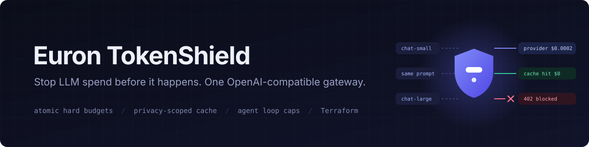
</p>

<p align="center">
  
  <a href="LICENSE"></a>
  
  
  
  
  
  
  
</p>

<p align="center">
  <a href="https://github.com/euron-sde-team/euron-open-tokenshield/stargazers"></a>
  <a href="https://github.com/euron-sde-team/euron-open-tokenshield/fork"></a>
  <a href="https://github.com/euron-sde-team/euron-open-tokenshield/watchers"></a>
  <br>
  <a href="https://github.com/euron-sde-team/euron-open-tokenshield/issues"></a>
  <a href="https://github.com/euron-sde-team/euron-open-tokenshield/pulls"></a>
  <a href="https://github.com/euron-sde-team/euron-open-tokenshield/commits/main"></a>
  
  <br>
  <a href="#built-by-the-team-behind-euron"></a>
</p>

<p align="center">
  <b><a href="#-quickstart">Quickstart</a></b> ·
  <b><a href="#️-architecture">Architecture</a></b> ·
  <b><a href="#-explore-the-repository">Explore the repo</a></b> ·
  <b><a href="docs/guides/integrate.md">Integrate</a></b> ·
  <b><a href="docs/api/openapi.yaml">API reference</a></b> ·
  <b><a href="#️-deploy-to-aws">Deploy</a></b> ·
  <b><a href="docs/architecture/security.md">Security</a></b> ·
  <b><a href="#-documentation">Docs</a></b>
</p>

**Euron Open TokenShield** is an open-source, MIT-licensed, self-hosted AI gateway, part of the
open-source initiative of **ENGAGESPHERE TECHNOLOGY PRIVATE LIMITED**. It sits between your
applications and their LLM providers and stops spend **before** it happens: every request is
attributed, priced, checked against hard budgets and waste rules, served from cache when it
safely can be, and only then forwarded.

Point any OpenAI SDK at it by changing `base_url`. Behind that one endpoint:

- **Hard budgets that hold under concurrency.** The worst-case cost of every request is
  reserved atomically against every applicable budget before the provider is called. Fifty
  simultaneous requests against a budget that fits ten: exactly ten reach the provider.
- **Caching that never leaks.** Identical requests are answered from cache, or coalesced while
  in flight, inside a partition you control: per project, per end user or per context.
- **Waste blocked at the door.** Retry storms, runaway agent loops, oversized prompts, huge
  output allowances and restricted models stop with an error that names the rule.
- **Every token accounted for.** Input, cached and output tokens, priced with the version in
  force, attributed to team, project, key, end user and agent task, with spend avoided
  reported separately.

The whole stack runs on a laptop against an AWS emulator, and deploys to AWS from the same
Terraform.

<p align="center">
  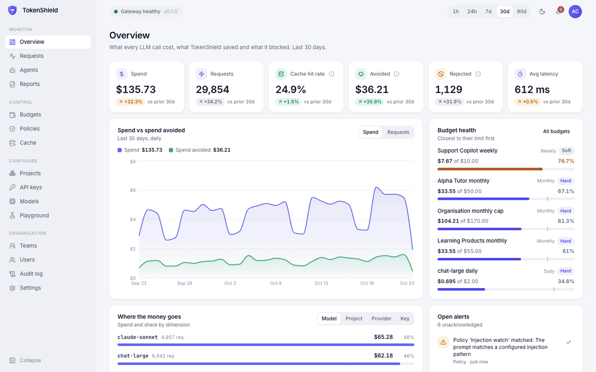
</p>

> [!NOTE]
> Everything in the tour ran for real: Docker Compose on a laptop, with KMS and S3 emulated
> locally and provisioned by the same Terraform modules that build production. The demo
> seed backfills 60 days of history; the most recent requests, cache hits and rejections are
> live traffic through the gateway to a mock provider. `make up && make demo` reproduces it.

<h3 align="center">Built by the team behind Euron</h3>

<p align="center">Euron Open TokenShield comes from the people who build these platforms. If you like how this repository is built, come and see what we build with it.</p>

<p align="center">
  <a href="https://euron.one"><picture><source media="(prefers-color-scheme: dark)" srcset="docs/assets/brand/euron-dark.svg"></picture></a>
  <a href="https://euronsystems.com"><picture><source media="(prefers-color-scheme: dark)" srcset="docs/assets/brand/euron-systems-dark.svg"></picture></a>
  <a href="https://alphaeuron.com"><picture><source media="(prefers-color-scheme: dark)" srcset="docs/assets/brand/alpha-euron-dark.svg"></picture></a>
</p>

<p align="center">
  <a href="https://www.instagram.com/euron_official"></a>
  <a href="https://www.linkedin.com/company/euronone/posts/"></a>
  <a href="https://x.com/euron712"></a>
  <a href="https://www.youtube.com/@Euron-official"></a>
  <a href="https://whatsapp.com/channel/0029VaeeJwq9RZAfPW9P2l07"></a>
</p>

---

## 📚 Table of contents

- [Why TokenShield](#-why-tokenshield)
- [At a glance](#-at-a-glance)
- [Screenshots](#️-screenshots)
- [Features](#-features)
- [Architecture](#️-architecture)
  - [Life of a request](#life-of-a-request)
- [Performance](#-performance)
- [Tech stack](#-tech-stack)
- [Prerequisites](#-prerequisites)
- [Quickstart](#-quickstart)
- [Explore the repository](#-explore-the-repository)
- [Integrate](#-integrate)
- [Configuration](#️-configuration)
- [Deploy to AWS](#️-deploy-to-aws)
- [Security model](#-security-model)
- [Testing](#-testing)
- [Documentation](#-documentation)
- [Roadmap](#️-roadmap)
- [FAQ](#-faq)
- [Contributing, security and license](#-contributing-security-and-license)

## 💡 Why TokenShield

LLM bills arrive after the fact. A buggy agent that loops overnight, a client that retries a
failing call in a tight loop, a leaked key, or a prompt that drags in a whole document can
burn a month of budget before anyone looks at a dashboard. Provider consoles report the
damage; they do not prevent it.

Most gateways track spend and check budgets with a read-then-call pattern, which concurrent
traffic walks straight through. TokenShield treats the budget as a hard contract:

- the worst case is **reserved** before the call, atomically, across every scope at once;
- a request whose outcome is unknown (a timeout after sending) is **never recorded as free**;
- cached answers are **partitioned**, so one user's private context is never served to another;
- when the budget store is unavailable, requests under hard budgets are **refused, not waved
  through**.

And it stays out of the way: about 2.5 ms of overhead per request, no SDK changes, and one
place to set limits and see exactly what was spent and what was avoided.

## 📊 At a glance

| | |
| --- | --- |
| **Surface** | OpenAI-compatible `/v1/chat/completions` (streaming), `/v1/embeddings`, `/v1/models` |
| **Providers** | Any OpenAI-compatible API (OpenAI, Ollama, vLLM, LM Studio, Groq) and the native Anthropic Messages API |
| **Budgets** | Hard or soft; by organisation, team, project, API key, end user or model; daily, weekly, monthly or lifetime |
| **Waste rules** | Prompt size, output caps, restricted models, prompt injection, retry storms, agent task caps |
| **Overhead** | 2.5 ms p50 per request; cache hits answered in 2.2 ms p50 ([how measured](#-performance)) |
| **Infrastructure** | 9 Terraform modules, 3 environments (local emulator, AWS dev, AWS prod) |
| **Tests** | 131 unit, 82 integration (run under 4 backend combinations), 11 browser end-to-end, a browser QA sweep |
| **License** | MIT |

## 🖼️ Screenshots

<table>
  <tr>
    <td width="50%"><br><sub><b>Overview.</b> Spend, requests, cache hit rate, spend avoided, rejections and latency against the previous period, with budget health.</sub></td>
    <td width="50%">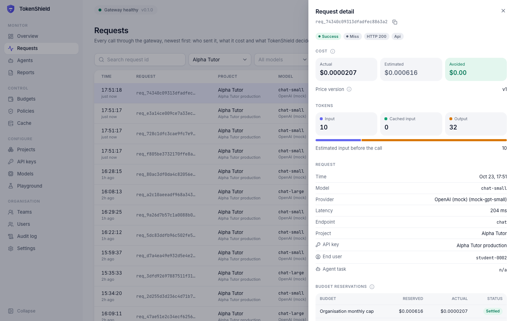<br><sub><b>Request detail.</b> Tokens, estimated and actual cost, price version, and every budget reservation from worst case to settled.</sub></td>
  </tr>
  <tr>
    <td>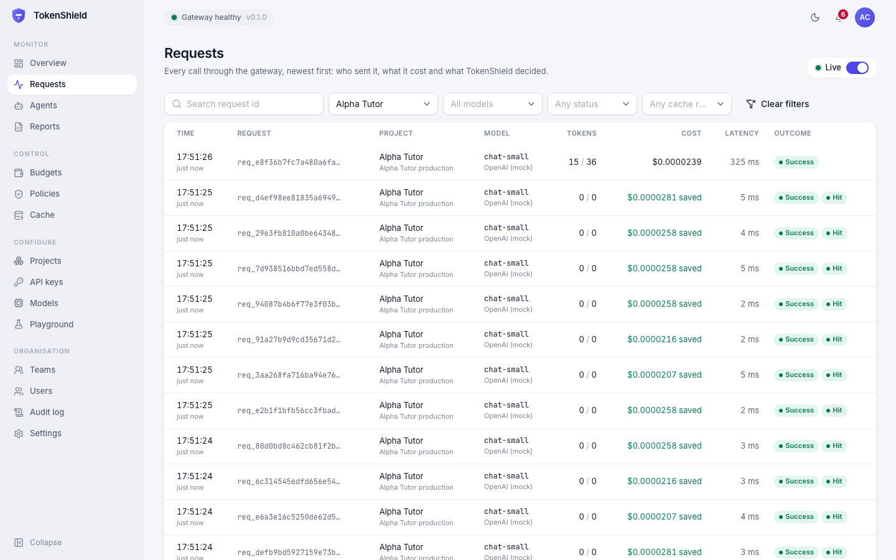<br><sub><b>Request log.</b> Every call, live, filterable by project, model, outcome and cache result.</sub></td>
    <td>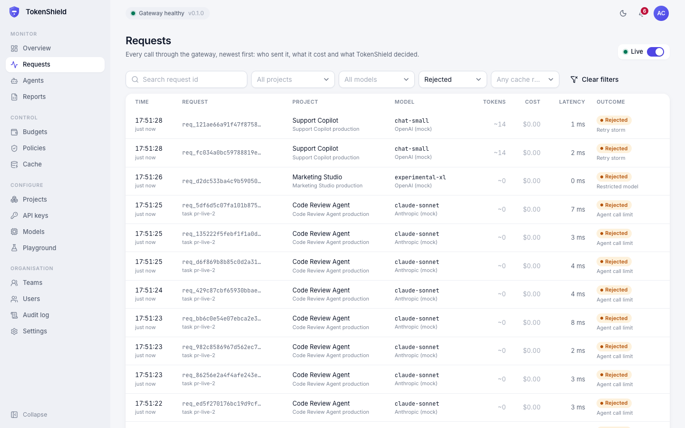<br><sub><b>Rejections.</b> Requests stopped before any provider call, with the rule that stopped them.</sub></td>
  </tr>
  <tr>
    <td>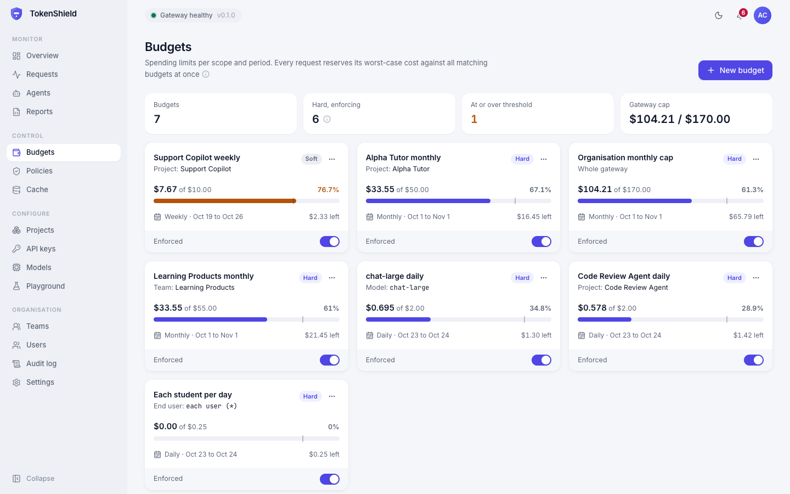<br><sub><b>Budgets.</b> Live spend against hard and soft limits, per scope and window.</sub></td>
    <td>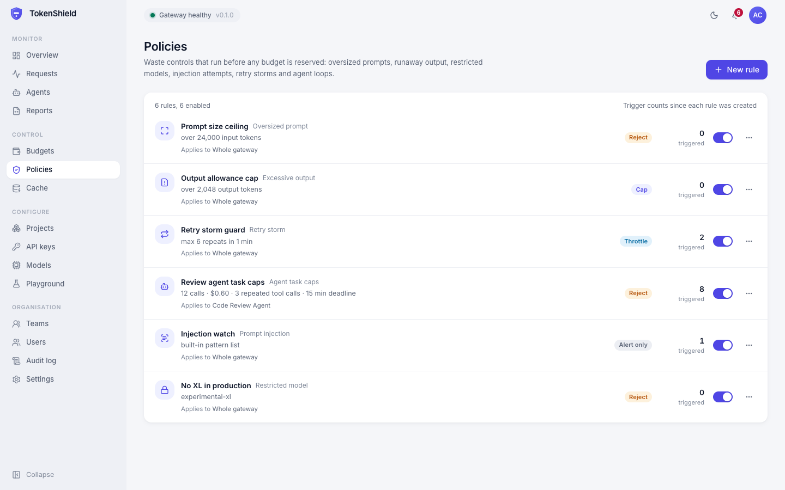<br><sub><b>Policies.</b> Waste rules with their actions and how often each has fired.</sub></td>
  </tr>
  <tr>
    <td>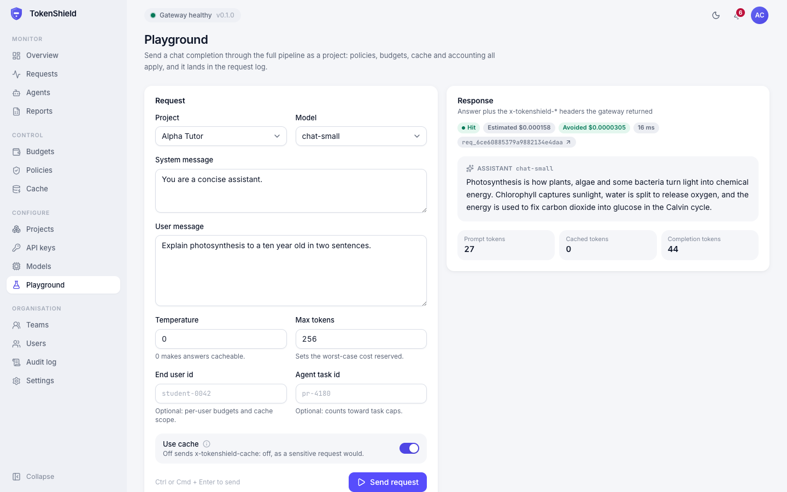<br><sub><b>Playground.</b> Send a request through the full pipeline; here a cache hit in 16 ms.</sub></td>
    <td>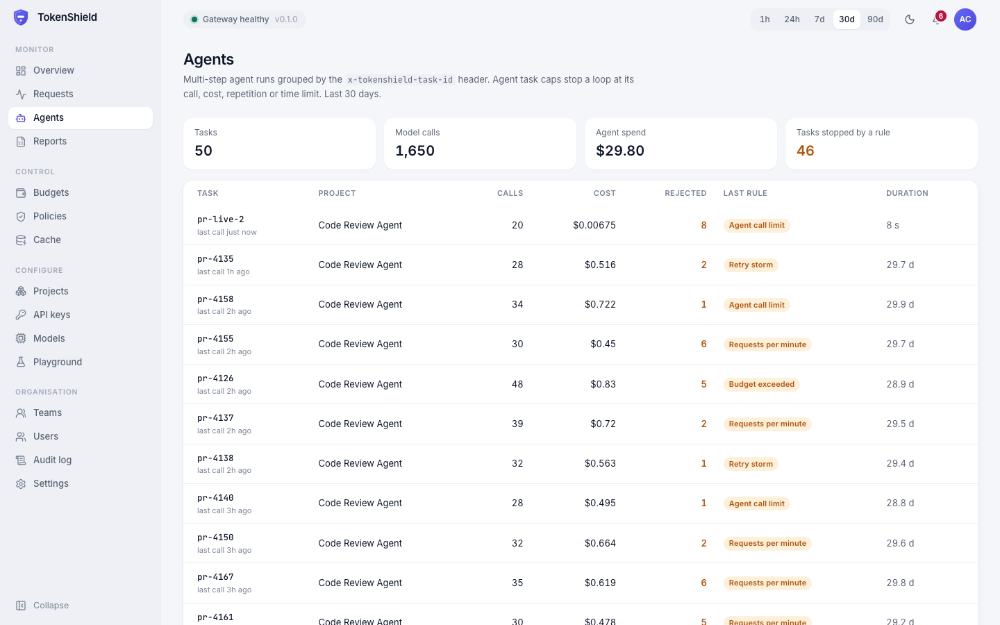<br><sub><b>Agent tasks.</b> Calls, cost and the cap that stopped a runaway task.</sub></td>
  </tr>
  <tr>
    <td>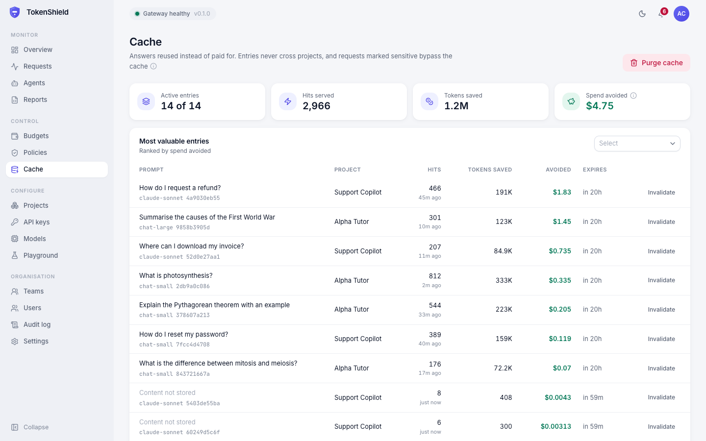<br><sub><b>Cache.</b> The entries saving the most, tokens saved and spend avoided.</sub></td>
    <td>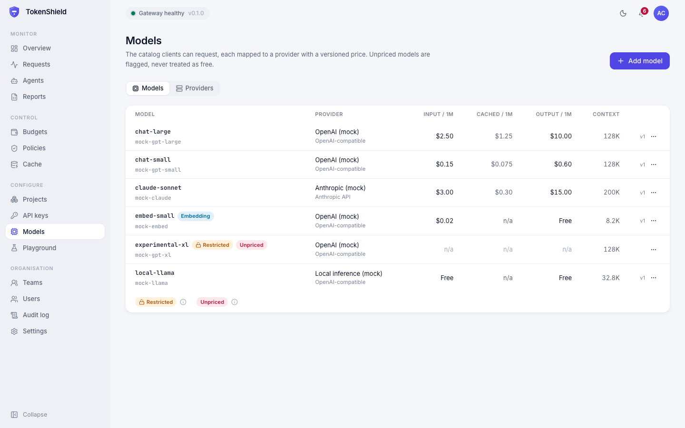<br><sub><b>Models.</b> Aliases mapped to providers, with versioned prices. Unpriced models are flagged, never free.</sub></td>
  </tr>
  <tr>
    <td>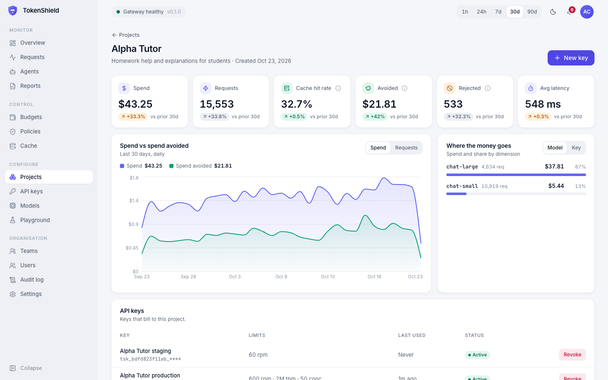<br><sub><b>Project.</b> One workload's spend, keys, cache settings and model access.</sub></td>
    <td>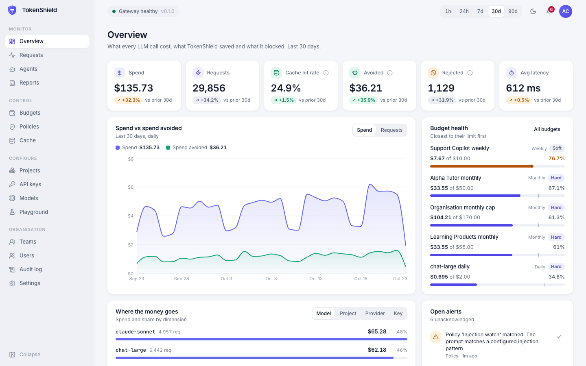<br><sub><b>Dark mode.</b> Every screen, in both themes.</sub></td>
  </tr>
  <tr>
    <td>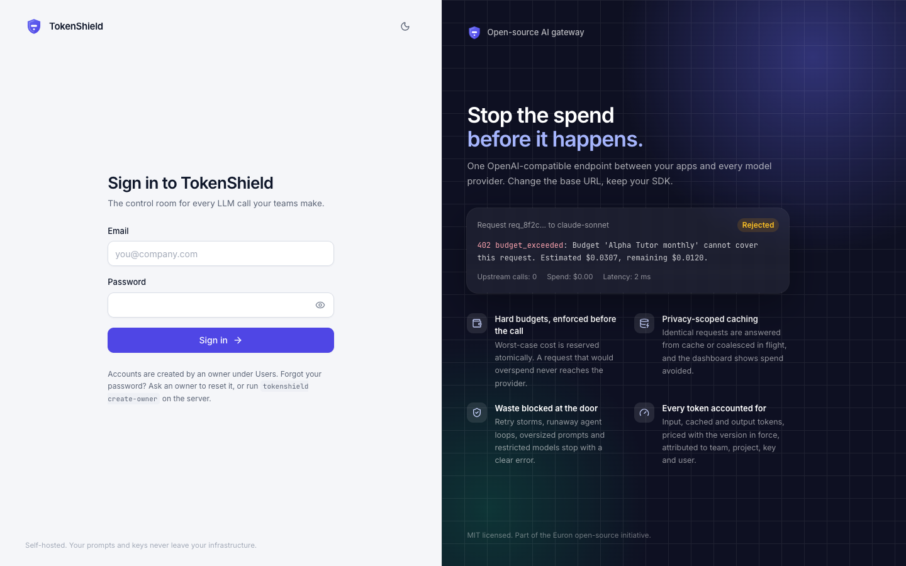<br><sub><b>Sign in.</b> Dashboard accounts with owner, admin and viewer roles.</sub></td>
    <td align="center">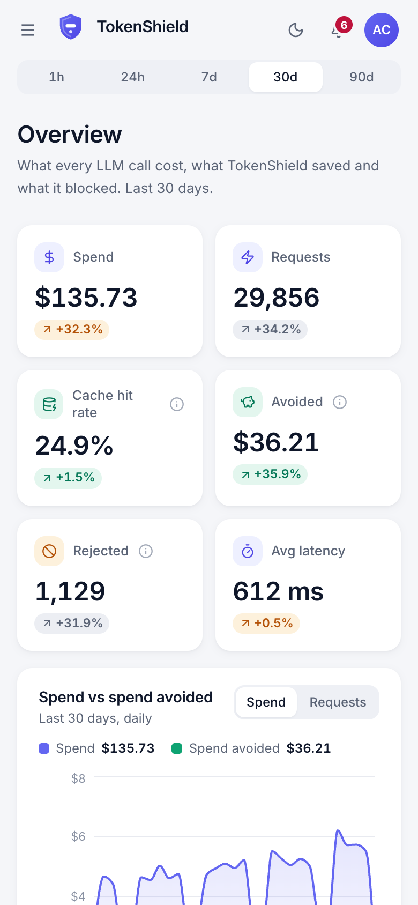<br><sub><b>Phone.</b> Responsive down to phone width.</sub></td>
  </tr>
</table>

## ✨ Features

<table>
<tr>
<td valign="top" width="50%">

#### 🛡️ Budgets and limits
- **Atomic reservations**: worst-case cost reserved against every applicable budget in one
  Redis Lua script, then settled to the provider-reported cost.
- **Scopes**: whole gateway, team, project, API key, end user (or each end user separately)
  and model. **Periods**: daily, weekly, monthly, lifetime. **Modes**: hard blocks, soft alerts.
- **Fail closed**: no proof of room, no call. Counters rebuild from the Postgres ledger.
- **Per-key limits**: requests per minute, tokens per minute, concurrent requests.
- **Unpriced models** are flagged and refused under hard budgets.

</td>
<td valign="top" width="50%">

#### ⚡ Caching
- **Exact-match cache** keyed on model, parameters, messages, tools and output schema.
- **Partitions**: per project, per end user or per declared context.
- **Request coalescing**: identical in-flight requests share one provider call.
- **Optional semantic cache** (pgvector), comparing only the final user turn within an
  exactly matching context.
- **Stream replay**: cached answers served as SSE to streaming clients.

</td>
</tr>
<tr>
<td valign="top">

#### 🧹 Waste prevention
- **Retry-storm throttling** on the paid path, per caller.
- **Agent task caps**: maximum calls, cost, repeated identical tool calls, deadline.
- **Prompt size and output caps**, with automatic output capping.
- **Restricted models**, project model allowlists, context-window checks.
- **Prompt-injection heuristics** (alert or reject).

</td>
<td valign="top">

#### 📈 Accounting and operations
- **Append-only ledger** of every request, reservation and correction; **audit log**.
- **Uncertain outcomes** held and settled at worst case, never recorded as free.
- **Idempotency keys**: retries never double bill or double count.
- **Analytics** over hourly rollups, CSV exports to S3, alerts, the agent view.
- **Prometheus metrics**, JSON logs with request ids, OpenTelemetry traces.

</td>
</tr>
</table>

## 🏗️ Architecture

<p align="center">
  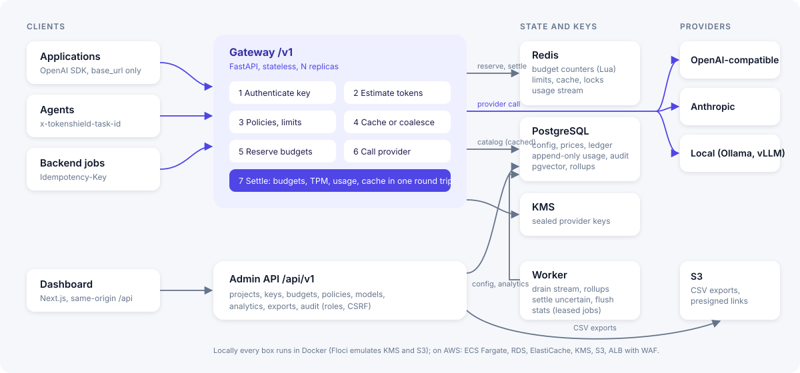
</p>

One Python package serves the gateway (`/v1`) and the dashboard API (`/api/v1`); a worker
process drains usage and runs background jobs; the Next.js dashboard proxies to the API.
Gateway configuration is cached in each process and invalidated cluster-wide through a Redis
version stamp, so the hot path never waits on Postgres.

### Life of a request

1. **Authenticate**: parse `tsk_<prefix>_<secret>`, check the peppered HMAC in constant time.
2. **Estimate**: count input tokens (tiktoken) and fix the output allowance.
3. **Police**: model access, prompt size, output caps, injection rules, key rate limits,
   agent task caps.
4. **Cache**: return a cached answer, or take the coalescing lock, or wait for the leader.
5. **Reserve**: check retry storms, then reserve the worst case against every budget.
6. **Call**: forward through the provider adapter; classify failures as not sent, uncertain
   or an error status.
7. **Settle**: actual cost replaces the reservation; TPM is trued up; the usage event is
   enqueued; the answer is cached. One Redis round trip.

A refused request costs one or two Redis round trips and never touches the provider. The
full walkthrough is in the [LLD](docs/architecture/LLD.md#the-request-pipeline-step-by-step).

## 🚀 Performance

Measured with `make bench` against the production images in Docker Compose on a laptop
(Apple silicon, Docker Desktop), sequential requests to a mock provider that answers in about
a millisecond, with a hard budget applied:

| | p50 | p95 |
| --- | --- | --- |
| Provider called directly | 1.2 ms | 2.0 ms |
| Through TokenShield, cache miss | 3.7 ms | 4.9 ms |
| Through TokenShield, cache hit | 2.2 ms | 3.0 ms |
| **Gateway overhead** | **2.5 ms** | **3.7 ms** |

The key design choices behind these numbers: no database on the request path, usage written
through a Redis Stream and drained by workers, and settlement in a single pipelined round
trip. Moving the usage write off the request path alone cut the in-process cost of a cache
miss from 24 ms to 3.6 ms ([ADR-0004](docs/architecture/adr/0004-usage-events-through-a-redis-stream.md)).

## 🧰 Tech stack

| Layer | Technology |
| --- | --- |
| Gateway, API, worker | Python 3.12, FastAPI, Pydantic v2, SQLAlchemy 2 (async, asyncpg), Alembic, redis-py, httpx, tiktoken |
| Dashboard | Next.js 15 (App Router), React 19, TypeScript, Tailwind CSS 4, shadcn components, TanStack Query, Recharts |
| Data | PostgreSQL 16 with pgvector, Redis 7 (Valkey on AWS) |
| AWS | ECS Fargate, ALB, WAF, RDS, ElastiCache, S3, KMS, Secrets Manager, ECR, CloudWatch |
| Local | Docker Compose, Floci (AWS emulator), a deterministic mock LLM provider |
| Quality | pytest, Vitest, Playwright, Puppeteer, ruff, mypy `--strict`, ESLint, tflint, checkov, gitleaks |

## 📋 Prerequisites

- Docker with Compose v2
- `make`, `bash`, `openssl`
- For development outside containers: Python 3.12 with [uv](https://docs.astral.sh/uv/),
  Node 22 and pnpm 9

## 🚀 Quickstart

```bash
git clone https://github.com/euron-sde-team/euron-open-tokenshield.git
cd euron-open-tokenshield
make up      # Postgres, Redis, Floci (provisioned by Terraform), mock LLM, api, worker, dashboard
make demo    # demo organisation, 60 days of history, live traffic; prints the login and a key
```

Open the dashboard at http://localhost:4110 and sign in with the printed credentials. Then
call the gateway like any OpenAI endpoint:

```python
from openai import OpenAI

client = OpenAI(base_url="http://localhost:4130/v1", api_key="tsk_...")  # the key make demo printed
reply = client.chat.completions.create(
    model="chat-small",
    temperature=0,
    messages=[{"role": "user", "content": "What is photosynthesis?"}],
)
```

Send it twice: the second answer comes from cache (`x-tokenshield-cache: HIT`) with zero
provider calls. [The quickstart guide](docs/guides/quickstart-local.md) walks through a
budget block, a retry storm and an agent cap. `make down` removes everything.

## 🧭 Explore the repository

```text
euron-open-tokenshield/
├── apps/
│   ├── api/                 Python package: gateway, admin API, worker, mock LLM
│   │   └── src/tokenshield/
│   │       ├── gateway/         the request pipeline, auth, catalog read model, streaming
│   │       ├── budgets/         reservation Lua scripts, scopes and windows, counter rebuild
│   │       ├── cache/           partitioned keys, response store, coalescing, semantic index
│   │       ├── policies/        static rules and stateful rules (retry storms, agent caps)
│   │       ├── limits/          sliding-window RPM/TPM and concurrency
│   │       ├── providers/       provider catalog and adapters (OpenAI-compatible, Anthropic)
│   │       ├── pricing/         versioned prices and the cost engine
│   │       ├── usage/           usage stream recorder, analytics, rollups, exports
│   │       ├── projects/ teams/ keys/ users/ auth/ alerts/ audit/ playground/ system/
│   │       ├── core/            config and boot guards, db, redis, errors, sealing, storage, tracing
│   │       ├── migrations/      Alembic revisions
│   │       └── worker.py        background jobs
│   └── web/                 Next.js dashboard (features/<domain>, components, lib)
├── infra/
│   ├── terraform/           modules + envs (local-floci, aws-dev, aws-prod)
│   └── docker/              api and web images
├── deploy/compose/          the local stack (Floci or real AWS overlay)
├── e2e/                     Playwright browser tests
├── scripts/                 QA sweep and screenshots, test matrix, sanitization check
└── docs/                    architecture, ADRs, guides, OpenAPI
```

## 🔌 Integrate

Any OpenAI-compatible client works. Optional headers unlock the rest:

| Header | Effect |
| --- | --- |
| `x-tokenshield-user` | End-user attribution, per-user budgets and user-scoped caching |
| `x-tokenshield-task-id` | Groups an agent's calls for task caps |
| `x-tokenshield-cache: off` | Never cache this request |
| `x-tokenshield-cache-scope` | `user`, or a context name, to control who may share cached answers |
| `Idempotency-Key` | Safe retries: no second provider call, no double counting |

Every response carries `x-tokenshield-request-id`, the cache result, the actual and
estimated cost and, on hits, the spend avoided. Errors use the OpenAI envelope with a stable
`code` (`budget_exceeded`, `retry_storm`, `agent_loop_detected` and more) and structured
`details`. See the [integration guide](docs/guides/integrate.md) and the
[OpenAPI reference](docs/api/openapi.yaml) (interactive at `/docs`).

## ⚙️ Configuration

All settings are environment variables, validated at boot; production refuses to start with
development secrets. The most important:

| Variable | Default | |
| --- | --- | --- |
| `BUDGET_FAILURE_MODE` | `closed` | Refuse hard-budget requests when Redis is unreachable |
| `KEY_MODE` | `local` | `kms` seals provider credentials with AWS KMS |
| `STORAGE` | `local` | `s3` for report exports |
| `DEFAULT_MAX_OUTPUT_TOKENS` | `1024` | Output allowance reserved when a request sets none |
| `SEMANTIC_CACHE` | `false` | Enable the semantic cache (projects opt in) |
| `STORE_CONTENT` | `false` | Keep prompts out of the database |

The full list is in the [configuration reference](docs/guides/configuration.md).

## ☁️ Deploy to AWS

```bash
cd infra/terraform/envs/aws-dev        # or aws-prod
cp terraform.tfvars.example terraform.tfvars
terraform init && terraform apply -target=module.ecr
# build and push the api and web images, then:
terraform apply
```

This creates a VPC, RDS PostgreSQL, ElastiCache (TLS, auth, `noeviction`), an encrypted
exports bucket, a KMS key, Secrets Manager entries, ECR, ECS Fargate services behind an ALB
with WAF, and CloudWatch alarms. The maintainers develop against the local emulator and keep
the AWS environments passing `terraform validate`, tflint and checkov on every change. Step
by step: [deploy guide](docs/guides/deploy-aws.md).

## 🔐 Security model

| Area | How |
| --- | --- |
| Gateway keys | `tsk_<prefix>_<secret>`, stored as a peppered HMAC, shown once, per-key limits and expiry, revocation live in about a second |
| Provider credentials | Write-only, sealed with KMS using a per-record encryption context, never returned or logged |
| Budgets | Atomic reservations, fail closed, uncertain outcomes held at worst case |
| Cache | Partitioned per project and optionally per user or context; sensitive requests opt out |
| Dashboard | argon2id, lockout and throttling, owner/admin/viewer roles enforced in the API, CSRF header, sessions die on password or role change |
| Data | Prompts not stored by default; append-only usage, reconciliation and audit tables; log redaction |
| Infrastructure | Private subnets, TLS everywhere, KMS encryption, least-privilege task roles, WAF, `/metrics` restricted, checkov clean |

Report vulnerabilities privately: see [SECURITY.md](SECURITY.md). Details:
[security](docs/architecture/security.md), [threat model](docs/architecture/threat-model.md).

## 🧪 Testing

| Suite | What it proves | Run |
| --- | --- | --- |
| Unit (131) | Cost engine, budget windows and scopes, policy rules, cache keys and eligibility, token estimates, provider translation, security primitives, config guards, dashboard logic and components | `make test` |
| Integration (82) | The real API against Postgres, Redis and a mock provider over HTTP: OpenAI SDK compatibility, zero upstream calls when refused, 50-way concurrency against a hard budget, cache isolation, coalescing, agent caps, timeouts, Redis outages, RBAC | `make test-integration` |
| Option matrix (4 runs) | The integration suite under every key and storage backend (local or KMS, disk or S3) on Floci | `make test-matrix` |
| Browser (11) | Create a project, key and budget in the dashboard, call the gateway, see it accounted and cached, see the overspend blocked; playground; exports; roles | `make e2e` |
| Browser QA | Every page in light and dark at desktop and phone width: no console errors, failed requests, broken images or overflow | `make qa` |
| Infrastructure | `terraform validate` (3 environments), tflint, checkov, shellcheck, sanitization (secrets, account ids, em and en dashes) | `make tf-validate tf-lint tf-security sanitize` |

[Testing guide](docs/guides/testing.md)

## 📖 Documentation

| Architecture | Guides |
| --- | --- |
| [High-level design](docs/architecture/HLD.md) | [Quickstart (local)](docs/guides/quickstart-local.md) |
| [Low-level design](docs/architecture/LLD.md) | [Integrate an application](docs/guides/integrate.md) |
| [Budget enforcement](docs/architecture/budgets.md) | [Configuration reference](docs/guides/configuration.md) |
| [Caching](docs/architecture/caching.md) | [Deploy to AWS](docs/guides/deploy-aws.md) |
| [Waste prevention](docs/architecture/waste-prevention.md) | [Local against real AWS](docs/guides/local-with-aws.md) |
| [Data model](docs/architecture/data-model.md) | [Operations runbook](docs/guides/operations.md) |
| [Security](docs/architecture/security.md) | [Testing](docs/guides/testing.md) |
| [Threat model](docs/architecture/threat-model.md) | [Troubleshooting](docs/guides/troubleshooting.md) |
| [Decision records](docs/architecture/adr/) | [Code walkthrough](docs/guides/walkthrough.md) |
| [API reference (OpenAPI)](docs/api/openapi.yaml) | |

## 🗺️ Roadmap

- Measured model routing: send simple requests to cheaper models when quality allows
- Context compression for long conversations
- Approval workflows for restricted models and budget raises
- SSO (OIDC and SAML) for the dashboard
- Provider-specific usage reconciliation for uncertain outcomes
- More native provider adapters, and an approximate index for the semantic cache
- A Helm chart alongside the Terraform

Have an idea? [Open a feature request](https://github.com/euron-sde-team/euron-open-tokenshield/issues/new/choose).

## ❓ FAQ

<details>
<summary><b>Do I need to change my application code?</b></summary>

No. Change the OpenAI client's `base_url` to the gateway and use a TokenShield key. The
optional headers add per-user budgets, agent caps and cache scoping.
</details>

<details>
<summary><b>Can a burst of parallel requests overspend a hard budget?</b></summary>

No. Each request reserves its worst-case cost atomically across every applicable budget
before the provider is called. The integration suite fires 50 concurrent requests at a
budget that fits 10 and asserts exactly 10 reach the provider.
</details>

<details>
<summary><b>Why was a request refused when the budget still had money left?</b></summary>

The reservation is the worst case: the full output allowance at the output price. Lower
`max_tokens` or add an output cap rule. The error's `details` show the estimate, the
remaining budget and the limit.
</details>

<details>
<summary><b>What happens if Redis goes down?</b></summary>

Requests under hard budgets are refused with 503 rather than allowed unchecked. Requests
with only soft budgets continue and are recorded directly to Postgres. When Redis returns,
budget counters rebuild from the Postgres ledger.
</details>

<details>
<summary><b>Can one user ever receive another user's cached answer?</b></summary>

Not when you scope the cache by user (`x-tokenshield-cache-scope: user`). Entries never
cross projects in any mode, and requests marked `x-tokenshield-cache: off` are never cached.
</details>

<details>
<summary><b>Are prompts stored?</b></summary>

No, by default. Cached answers live in Redis for their TTL only. `STORE_CONTENT=true` adds
short prompt excerpts for debugging.
</details>

<details>
<summary><b>Do I need an AWS account to try it?</b></summary>

No. `make up` runs everything on Docker, with KMS and S3 on a local emulator provisioned by
the same Terraform modules as production, and a mock provider so no real keys are needed.
</details>

## 🤝 Contributing, security and license

Contributions are welcome: read [CONTRIBUTING.md](CONTRIBUTING.md) and the
[code of conduct](CODE_OF_CONDUCT.md). Report security issues privately as described in
[SECURITY.md](SECURITY.md).

Released under the [MIT License](LICENSE). Copyright (c) 2026 ENGAGESPHERE TECHNOLOGY
PRIVATE LIMITED and the Euron Open TokenShield contributors.

<p align="center">
  If TokenShield saves you money, <b><a href="https://github.com/euron-sde-team/euron-open-tokenshield/stargazers">⭐ star the repository</a></b>.
</p>
