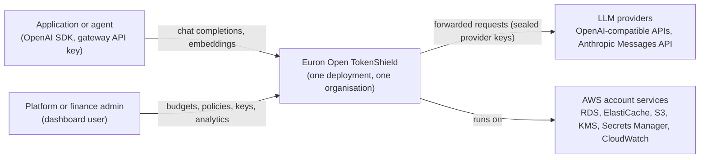
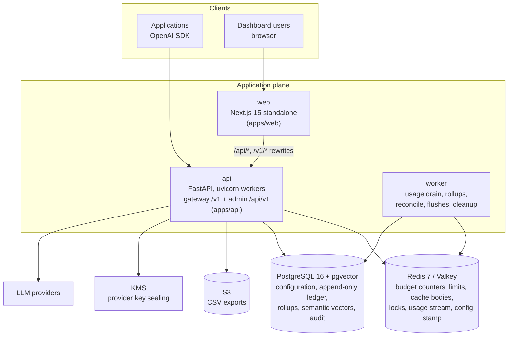
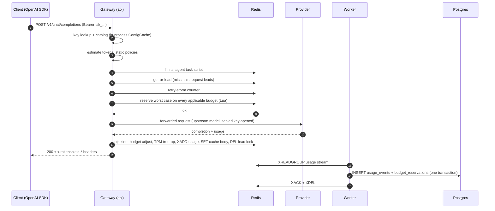
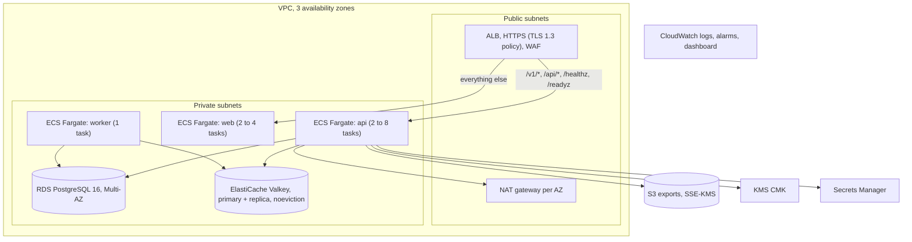

# High-Level Design

This document describes what Euron Open TokenShield is made of, how the pieces talk to each
other, and how the system behaves under load and failure. The module-level detail is in the
[Low-Level Design](LLD.md), the tables in the [Data Model](data-model.md), the two subsystems
that carry most of the correctness argument in [Budgets](budgets.md) and
[Caching](caching.md), and the reasoning behind each major choice in the
[ADRs](adr/README.md).

- [Goals and non-goals](#goals-and-non-goals)
- [System context](#system-context)
- [Containers](#containers)
- [Component responsibilities](#component-responsibilities)
- [The request pipeline](#the-request-pipeline)
- [Main flows](#main-flows)
- [Caching layers](#caching-layers)
- [Deployment topology](#deployment-topology)
- [Scalability](#scalability)
- [Availability and failure modes](#availability-and-failure-modes)
- [Security summary](#security-summary)
- [Observability](#observability)
- [Key design decisions](#key-design-decisions)

## Goals and non-goals

TokenShield is a self-hosted AI gateway. Applications send OpenAI-compatible requests to it
instead of to a provider; it attributes, prices and polices each request, serves it from
cache when that is safe, and only then forwards it. The name is the contract: a shield
stops spend before it happens, it does not chart it afterwards.

**Goals**

| # | Goal | How it is met |
| - | ---- | ------------- |
| G1 | Any OpenAI SDK works by changing only `base_url` and `api_key` | OpenAI-compatible `/v1/chat/completions` (streaming and not), `/v1/embeddings`, `/v1/models`; provider adapters translate behind that surface |
| G2 | A request that would breach a hard budget never reaches the provider | Worst-case cost reserved atomically across every applicable budget in one Redis Lua script, as the last gate before the upstream call |
| G3 | Concurrency cannot overspend | The reservation is a single atomic check-and-increment, so N parallel requests cannot all see the same remaining balance |
| G4 | Every request is accounted, nothing is recorded as free by accident | Append-only `usage_events` with provider-reported tokens and the price version used; unknown outcomes are held at the worst case and settled by the worker |
| G5 | Avoid paying twice for the same answer | Exact-match response cache, request coalescing, optional semantic cache, all scoped by project and caller-declared scope |
| G6 | Contain runaway automation | Retry-storm throttling, agent task caps (calls, cost, deadline, repeated tool calls), per-key RPM, TPM and concurrency limits |
| G7 | One place to see actual and avoided spend | Hourly rollups, analytics endpoints, a request log, CSV export, a Next.js dashboard |
| G8 | Runnable on a laptop without an AWS account | Local AWS emulator (Floci) provisioned by the same Terraform modules as production |

**Non-goals**

- **Multi-tenancy inside one deployment.** One install serves one organisation; teams,
  projects and keys live inside it ([ADR-0001](adr/0001-single-tenant-deployments.md)).
- **Model routing and prompt rewriting.** TokenShield forwards to the provider the model
  alias maps to. Measured routing and context compression are on the roadmap
  ([PLAN.md](../PLAN.md#roadmap-not-010)).
- **Exact provider invoices.** Costs come from a versioned price catalog the operator
  maintains and from provider-reported token counts. They track the invoice closely; they are
  not the invoice.
- **End-user identity.** TokenShield sees an opaque end-user id the calling application
  sends (`x-tokenshield-user`); it never authenticates end users.

## System context

C4 level 1: TokenShield and the actors around it.



## Containers

C4 level 2: the deployable units and their stores. All three application processes come from
two images: the API image runs the gateway, the admin API, the worker and the one-off CLI;
the web image runs the dashboard.



## Component responsibilities

| Component | Code | Runs as | Owns | Never does |
| --------- | ---- | ------- | ---- | ---------- |
| Gateway | [`apps/api/src/tokenshield/gateway`](../../apps/api/src/tokenshield/gateway) | Inside every api process | Key auth, model resolution, token estimate, the request pipeline, settlement, response headers | Write to Postgres on the success path (usage goes to the Redis stream) |
| Admin API | the other domain packages under [`apps/api/src/tokenshield`](../../apps/api/src/tokenshield) | Inside every api process | Users, teams, projects, keys, providers, models and prices, budgets, policies, cache admin, analytics, exports, alerts, audit | Serve gateway traffic |
| Worker | [`worker.py`](../../apps/api/src/tokenshield/worker.py) | Separate process, same image (`tokenshield worker`) | Drains the usage stream into Postgres, hourly rollups, settles `UNCERTAIN` requests, flushes cache and policy counters, cleanup | Take any HTTP traffic |
| Dashboard | [`apps/web`](../../apps/web) | Next.js standalone server | Every admin screen, the Playground; same-origin proxy of `/api` and `/v1` to the api | Hold a credential other than the httpOnly session cookie |
| Provider adapters | [`providers/adapters`](../../apps/api/src/tokenshield/providers/adapters) | Library inside the api | Translate the OpenAI shape to a provider's native API and back; classify transport failures as not-sent or uncertain | Decide anything about budgets or caching |
| Mock LLM | [`apps/api/src/mockllm`](../../apps/api/src/mockllm) | Compose service locally, a thread in the integration tests | Deterministic OpenAI and Anthropic compatible upstream with call counters | Run in production |

## The request pipeline

The gateway runs one fixed sequence per chat completion. The order is the design: free checks
first, cached answers only after authorization and policy, spend reserved last, accounting in
one round trip.

```
  auth (API key, peppered HMAC, ConfigCache)
   -> model resolution (alias -> provider, upstream model, price)
   -> token estimate (tiktoken, chars/4 fallback)
   -> static policies (allowlist, restricted, context window, size, output, injection)
   -> limits (RPM, TPM, concurrency per key)
   -> agent task caps (x-tokenshield-task-id)
   -> cache lookup (get-or-lead script, semantic if enabled, coalescing wait)
        hit -> serve, record HIT with avoided cost, done
   -> retry-storm check (paid path only, per key + end user)
   -> atomic budget reservation (Lua across all counters; hydrate from Postgres; fail closed)
   -> provider call (not-sent vs uncertain classification)
   -> settlement in ONE Redis pipeline
        (budget adjust, TPM true-up, usage XADD, cache store, lead release)
   ... worker drains the usage stream into Postgres (consumer group, ack after commit)
```

Every step before the provider call is answered from process memory or Redis. Postgres is on
the request path only when a budget counter has to be rebuilt (first use in a window, or after
Redis lost data), when the semantic cache is on, or when Redis is unreachable and a usage
record falls back to a direct insert. The step-by-step version, with the Redis commands each
step issues, is in [LLD.md](LLD.md#the-request-pipeline-step-by-step).

## Main flows

### A paid request (cache miss)



### A request the budget refuses

The reservation script finds a hard budget without room and returns its index. The gateway
answers `402 budget_exceeded` with the budget's name, period, limit, spend and the request's
estimate, records a `REJECTED` usage event, and the provider receives nothing. Integration
test `test_ac2_exhausted_budget_rejects_with_zero_upstream_calls` asserts the mock upstream's
call counter stays at zero.

### A cache hit

Authorization, limits, static policies and agent task caps still run. The get-or-lead script
returns the stored body; the gateway rewrites `id`, `created` and `model`, records a `HIT`
usage event whose `avoided_cost_nusd` is what the original answer would cost today, bumps the
entry's hit statistics, and returns. No budget is reserved and the retry-storm counter is not
touched, because a cached answer costs nothing. See [caching.md](caching.md).

### An uncertain outcome

The provider accepted the request but no answer arrived (read timeout, dropped connection),
or the client disconnected mid-stream. TokenShield cannot know whether the provider billed it,
so it records the event as `UNCERTAIN` and **keeps the reservation**. After
`UNCERTAIN_SETTLE_AFTER_S` the worker settles it at the reserved worst case with a
reconciliation event ([ADR-0006](adr/0006-uncertain-outcomes-are-never-free.md)).

## Caching layers

| Layer | What | Where | Key | TTL | Invalidation |
| ----- | ---- | ----- | --- | --- | ------------ |
| Gateway config | API key records, the catalog snapshot (models, prices, projects, budgets, rules, opened provider keys) | In-process dict per api process | `key:<prefix>`, `catalog` | 5 s | Any admin write increments `ts:cfg:version`; every process compares its stamp at most once a second and drops its copy when it moved |
| Opened provider keys | Decrypted provider credentials | In-process dict | provider id + SHA-256 of the sealed blob | Process lifetime | A new sealed value has a new digest, so a rotated key is opened again |
| Response cache | Chat completion bodies (zlib above 1 KiB) | Redis `ts:cache:body:<sha256>` | SHA-256 over model, canonical messages, output-affecting params and the partition (project + scope) | Project `cache_ttl_s` (default 3600 s) | Expiry; manual purge per entry or per project; also deletes semantic vectors |
| Coalescing lock | Which request leads for a key | Redis `ts:cache:lock:<sha256>` | Same key | `COALESCE_WAIT_S` | Deleted by the leader in its settlement pipeline or when it fails |
| Semantic cache | Embedding of the last user turn, pointing at an exact entry | Postgres `semantic_cache` (pgvector) | Partition hash of everything except the last user turn | Same as the entry | Purged with the exact entry; expired rows deleted hourly |
| Budget counters | Settled spend plus outstanding reservations per budget window | Redis `ts:bud:<budget>:<window>:<scope>` | Budget, window label, scope value | Window end plus one day | Rebuilt from Postgres when missing |
| Analytics | Overview, time series, breakdown responses | Redis `ts:an:<query>` over Postgres rollups | Query parameters | 10 s | Expiry only (dashboards poll) |
| Rollups | Hourly aggregates by project, key, model, provider, status, cache status | Postgres `usage_rollups_hourly` | Hour + dimensions | Recomputed every minute for the last few closed hours | Recompute is idempotent; the open hour is always read raw |
| Dashboard server state | API responses | TanStack Query in the browser | Per resource | `staleTime` 10 s analytics, 30 s config, 5 s live request log | Invalidated on mutation |

The full key design, eligibility rules and an invalidation table are in
[caching.md](caching.md).

## Deployment topology

On AWS ([`infra/terraform/envs/aws-prod`](../../infra/terraform/envs/aws-prod)):



`aws-dev` is the same composition with two AZs, a single NAT gateway, a single-AZ database,
one cache node and smaller autoscaling ceilings. Locally, `make up` runs the same images in
Docker Compose with Postgres and Redis as containers and S3, KMS and Secrets Manager on Floci,
provisioned by `infra/terraform/envs/local-floci`. See [deploy-aws.md](../guides/deploy-aws.md)
and [quickstart-local.md](../guides/quickstart-local.md).

## Scalability

- **Stateless api processes.** Every piece of shared state (counters, limits, locks, cache
  bodies, the usage buffer, the config stamp) is in Redis, every durable fact in Postgres.
  Any number of api tasks, each with any number of uvicorn workers (`WEB_CONCURRENCY`,
  default 2), can serve the same deployment. Coordination is by atomic Redis operations,
  never by in-process locks alone.
- **The hot path is Redis-bound.** A cache miss costs a handful of Redis round trips plus the
  provider call; the settlement is one pipeline. Before usage writes moved to a Redis stream,
  a synchronous Postgres insert cost about 10.6 ms p50 per request on a local laptop stack
  ([ADR-0004](adr/0004-usage-events-through-a-redis-stream.md)).
- **Postgres writes are batched.** The worker writes up to 500 usage records per
  transaction; duplicate request ids are ignored, so redelivery is harmless.
- **Dashboards read rollups.** Analytics cost scales with hours times dimensions, not with
  requests. The still-open hour, and any hour the worker has not rolled up yet, is read from
  raw events, so a lagging worker never leaves a gap.
- **Workers scale out safely.** Every worker drains the usage stream through one consumer
  group; periodic jobs take a Redis lease, so exactly one instance runs each job per interval.

## Availability and failure modes

| Failure | Behaviour |
| ------- | --------- |
| Redis unreachable | Requests that touch a hard budget get `503 budget_service_unavailable` with zero upstream calls (fail closed, `BUDGET_FAILURE_MODE=closed`). Limits, agent caps and retry-storm checks answer `503` when they need Redis. The cache degrades to a miss. Usage records fall back to a direct Postgres insert. `/readyz` reports 503. Config refreshes on TTL only. |
| Redis lost its data | Budget counters are rebuilt from Postgres on next use. Up to about a second of usage events not yet drained from the stream can be lost (AOF `everysec`). See [budgets.md](budgets.md#failure-modes). |
| Postgres unreachable | Gateway requests keep working only while each process's configuration copy is fresh (at most the 5 s TTL); once it expires the catalog cannot be reloaded and requests fail with 500. Usage already in the Redis stream waits there until the worker can commit it. Admin endpoints fail. `/readyz` reports 503. |
| Worker down | Gateway traffic is unaffected. The dashboard request log and analytics lag behind (events wait in the stream, capped at about 1,000,000 entries), `UNCERTAIN` requests stay unsettled, cache statistics stop updating. |
| Provider timeout after send | `504 upstream_timeout`, event `UNCERTAIN`, reservation held, settled by the worker. |
| Provider connect failure or error status | Reservation released, `ERROR` event, `502` (or the provider's status when it is a meaningful client error). |
| Leader of a coalesced key fails | The lead lock is dropped; a waiting follower takes over and calls the provider itself. |
| A configuration change | Visible on every api process within about a second (version stamp check interval), at worst within the 5 s TTL if Redis is down. |

## Security summary

Gateway keys are `tsk_<prefix>_<secret>`, stored as an HMAC-SHA256 of the secret under a
server-side pepper. Dashboard users sign in with argon2-hashed passwords, get an HS256 session
JWT in an httpOnly cookie, and cookie-authenticated mutations require a custom CSRF header.
Provider API keys are sealed with KMS (or AES-GCM locally) with an encryption context bound to
the provider row, and are never returned by the API. Production refuses to boot with demo
secrets. Details in [security.md](security.md); threats and residual risks in
[threat-model.md](threat-model.md).

## Observability

- **Logs:** one JSON line per request with method, path, status, latency and request id;
  credentials redacted by key name. Budget rejections log `event=budget_rejected`, which the
  CloudWatch metric filter in the `observability` module turns into an alarmable metric.
- **Metrics:** Prometheus `/metrics` on the api: request outcomes by model, status and cache
  status; rejections by rule; tokens; actual and avoided spend in USD; upstream latency; and
  the gateway's own overhead as a histogram. See [operations.md](../guides/operations.md#metrics).
- **Probes:** `/healthz` (liveness, no dependencies) and `/readyz` (Postgres and Redis, 2 s
  timeout each).
- **Request ids:** every response carries `x-request-id` (an incoming value is honoured when
  it is alphanumeric); gateway responses also carry `x-tokenshield-request-id`, the id the
  usage event is stored under.

## Key design decisions

| Decision | ADR |
| -------- | --- |
| One deployment serves one organisation | [ADR-0001](adr/0001-single-tenant-deployments.md) |
| Atomic budget reservations in Redis, last gate before the provider | [ADR-0002](adr/0002-atomic-budget-reservations-in-redis.md) |
| Money is integer nano-dollars | [ADR-0003](adr/0003-integer-nano-dollars.md) |
| Usage events go through a Redis stream, drained by the worker | [ADR-0004](adr/0004-usage-events-through-a-redis-stream.md) |
| Local AWS emulation with Floci and the same Terraform | [ADR-0005](adr/0005-local-aws-emulation.md) |
| Uncertain outcomes are never free | [ADR-0006](adr/0006-uncertain-outcomes-are-never-free.md) |
| Python and FastAPI for the API, Next.js for the dashboard | [ADR-0007](adr/0007-python-fastapi-and-nextjs.md) |
| Exact cache first, semantic cache behind a flag | [ADR-0008](adr/0008-exact-cache-first-semantic-behind-a-flag.md) |
