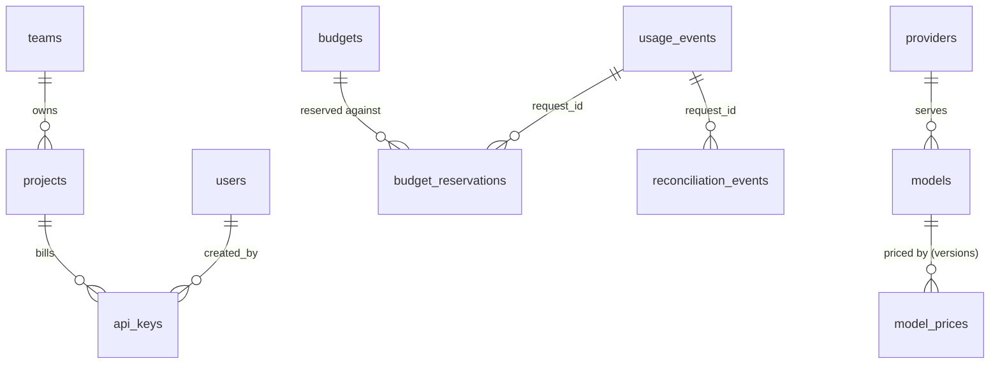

# Data model

PostgreSQL 16 with the `vector` extension. The schema is owned by Alembic
(`apps/api/src/tokenshield/migrations/versions/`); SQLAlchemy models live in each domain's
`models.py`. Money columns are `BIGINT` nano-dollars (`*_nusd`, see
[ADR-0003](adr/0003-integer-nano-dollars.md)); prices are `NUMERIC(14,6)` USD per million
tokens.

## Configuration

| Table | Purpose | Notable columns |
| --- | --- | --- |
| `users` | Dashboard accounts | `email` unique, `password_hash` (argon2), `role` owner/admin/viewer, `disabled`, `failed_logins`, `locked_until`, `session_version` (bumped to end sessions) |
| `teams` | Groups of projects | `slug` unique |
| `projects` | Workloads that consume AI | `team_id`, cache settings (`cache_enabled`, `cache_ttl_s`, `cache_nondeterministic`, `semantic_cache_enabled`), `allowed_models` (JSONB list, null = all unrestricted), `archived` |
| `api_keys` | Gateway credentials | `prefix` unique (12 hex chars, the lookup key), `secret_hash` (peppered HMAC-SHA256), `rpm_limit`, `tpm_limit`, `concurrency_limit`, `expires_at`, `revoked_at`, `last_used_at` (written at most once a minute) |
| `providers` | Upstream APIs | `kind` openai/anthropic, `base_url`, `sealed_key` (KMS or AES-GCM ciphertext, never returned), `key_hint` (last four characters), `timeout_s` |
| `models` | Aliases clients request | `alias` unique, `provider_id`, `upstream_model`, `kind` chat/embedding, `tokenizer`, `context_window`, `max_output_tokens`, `restricted` |
| `model_prices` | Immutable price versions | `(model_id, version)` unique, `input_per_m`, `cached_input_per_m` (null = input price), `output_per_m`, `effective_from` |
| `budgets` | Spend limits | `scope_type` global/team/project/api_key/end_user/model, `scope_id` (`*` = each end user), `period` daily/weekly/monthly/total, `limit_nusd`, `mode` hard/soft, `alert_threshold_pct` |
| `policy_rules` | Waste rules | `kind`, `scope_type`, `scope_id`, `params` JSONB (validated per kind), `action`, `triggered_count` (flushed from Redis by the worker) |

## Accounting (append-only)

| Table | Purpose | Notable columns |
| --- | --- | --- |
| `usage_events` | One row per request, whatever the outcome | `request_id` unique, attribution (`project_id`, `team_id`, `api_key_id`, `source` api/playground, `end_user`, `task_id`), `model_alias`, `provider`, `upstream_model`, token counts (`input_tokens` includes `cached_input_tokens`, `output_tokens`, `estimated_input_tokens`), `usage_source` provider/estimate/cache/none, `estimated_cost_nusd`, `actual_cost_nusd`, `avoided_cost_nusd`, `price_id`, `priced`, `cache_status` MISS/HIT/SEMANTIC_HIT/COALESCED/BYPASS, `status` SUCCESS/REJECTED/ERROR/UNCERTAIN, `rule`, `reason`, `http_status`, `latency_ms`, `stream`, `prompt_excerpt` (only with `STORE_CONTENT=true`) |
| `budget_reservations` | Ledger of reservations per budget | `request_id`, `budget_id`, `counter_key`, `amount_nusd` (worst case), `actual_nusd`, `status` settled/released/uncertain |
| `reconciliation_events` | Corrections to recorded spend | `request_id`, `delta_cost_nusd`, `reason` (for example `uncertain_settled_at_reservation`) |
| `audit_log` | Every dashboard mutation | `actor_id`, `actor_email`, `action`, `target_type`, `target_id`, `details`, `ip` |

`usage_events`, `reconciliation_events` and `audit_log` are append-only: a trigger
(`tokenshield_refuse_change`) raises on any `UPDATE` or `DELETE`. Corrections are new rows.
Inserts into `usage_events` use `ON CONFLICT (request_id) DO NOTHING`, so a replayed batch
from the usage stream never double counts, and ledger rows are written only for events
that were new.

## Derived and operational

| Table | Purpose |
| --- | --- |
| `usage_rollups_hourly` | Pre-aggregated usage per hour, project, key, model, provider, status and cache status, including reconciliation deltas. Maintained by the worker; analytics read rollups for closed hours and raw events after the last rolled hour |
| `cache_entries` | Statistics for cached responses (hits, tokens saved, avoided cost). Bodies live in Redis |
| `semantic_cache` | pgvector embeddings of final user turns, per partition |
| `alerts` | Budget threshold and policy alerts, `dedupe_key` unique so a rule firing repeatedly creates one alert per hour |
| `exports` | Report exports and their object keys in S3 or local storage |

## Indexes

Every filter the API exposes has an index: usage events by `created_at`, and by
`(project_id, created_at)`, `(api_key_id, created_at)`, `(model_alias, created_at)`,
`(team_id, created_at)`, `(end_user, created_at)` where an end user is set, `task_id`, and a
partial index on `created_at` where `status = 'UNCERTAIN'` for the reconciliation sweep.
Open reservations are indexed by `counter_key` (partial, status reserved or uncertain) for
counter rebuilds. The request log paginates by primary key (keyset), so page cost is
constant at any depth.
